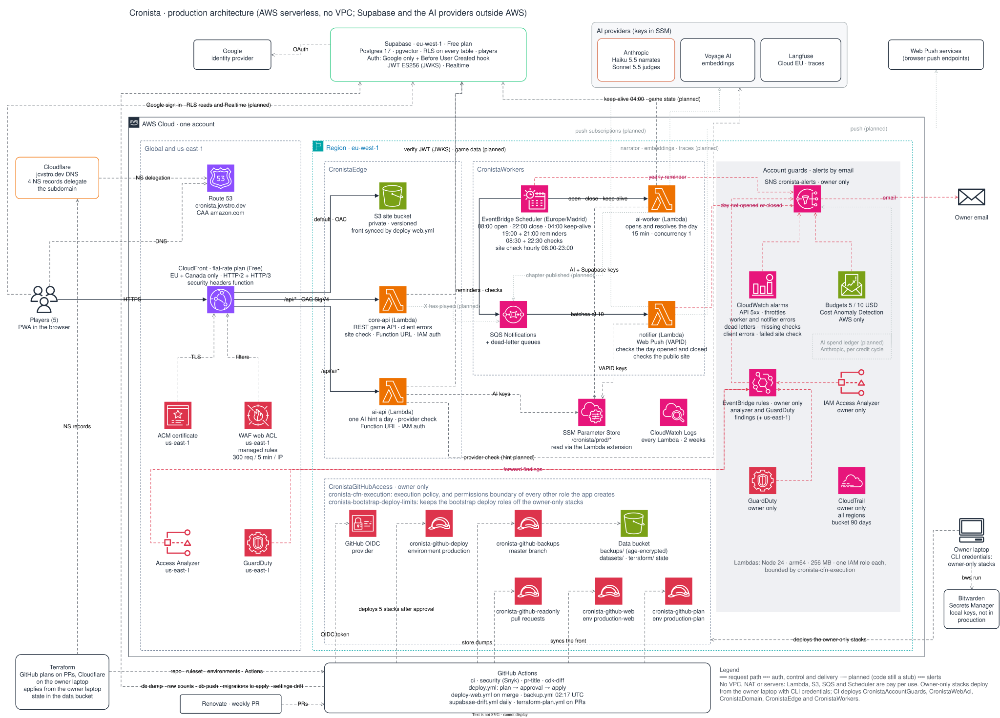

# Architecture

Summary of the architecture document (private). It only covers what you need to work on the code.

## Release plan

Three weekly versions of the game. The major number of the app's version is the game version.

| Version      | Target     | Release | What it adds                                                                                                                                                             | Done when                                                                                             |
| ------------ | ---------- | ------- | ------------------------------------------------------------------------------------------------------------------------------------------------------------------------ | ----------------------------------------------------------------------------------------------------- |
| v1, playable | 2026-11-08 | `1.0.0` | Game rules, game and memory schema, full RAG (tools and local MCP included), narrator and daily loop, spend ledger, the React front with its second design, PWA and push | A simulated season of 5 invented players runs clean and the 5 players are in. Known bugs are accepted |
| v2, better   | 2026-11-15 | `2.0.0` | Fixes and friction reported by the players, `evals` required in CI                                                                                                       | No reported bug blocks play                                                                           |
| v3, complete | 2026-11-22 | `3.0.0` | Final design and experience, accessibility, the Sonnet judge and its calibration, end-of-season consolidation                                                            | Owner's sign-off, no known bug affects play, and season 1 starts                                      |

v1 and v2 are a pre-season (season 0): its game data can be reset, so a schema change may rewrite game tables instead of migrating their rows (`database.md`). `players` is kept. Season 1 starts clean with v3.

## Diagram

It is large: open [`architecture.svg`](architecture.svg) at full size to read it. The source is [`architecture.drawio`](architecture.drawio): edit it in draw.io (desktop app, VS Code extension or app.diagrams.net) and export it again as `architecture.svg` in the same change. Calls whose code is still a stub are drawn as planned, and calls that only deploys or self-checks make are left to the labels of their boxes.

## Components

| Component       | Where                   | Technology                                                                                                                      |
| --------------- | ----------------------- | ------------------------------------------------------------------------------------------------------------------------------- |
| Front end (PWA) | `apps/web`              | Static React + Vite SPA with Tailwind and Motion (ADR-15), components copied in (ADR-31); see `apps/web/README.md`              |
| Game API        | `services/core-api`     | Node 24 arm64 Lambda + Function URL at `/api/*`, behind CloudFront with OAC (ADR-23)                                            |
| AI hint API     | `services/ai-api`       | Lambda + Function URL at `/api/ai/*`: one hint per player and day, with reserved concurrency                                    |
| Day worker      | `services/ai-worker`    | Lambda without a URL, run by EventBridge Scheduler: opens the day and resolves it at closing time, idempotent per (season, day) |
| Notifications   | `services/notifier`     | Lambda fed by an SQS queue, where Scheduler also queues the reminders at 19:00 and 21:00: Web Push with VAPID (ADR-16)          |
| Game engine     | `packages/engine`       | The rules of a game day over the store, the narrator and the bible; the Lambdas and local runs call the same interface          |
| Domain          | `packages/core`         | Types, Zod schemas and calendar rules; no Node dependencies                                                                     |
| API edge        | `packages/http`         | Session JWT verification, request bodies and JSON responses for `core-api` and `ai-api`; the check of the public site           |
| SSM parameters  | `packages/parameters`   | The Lambdas' SecureString parameters, read through the Parameters and Secrets extension                                         |
| Narrator        | `packages/narrator`     | AI SDK 7 + Claude Haiku 5.5 and the context budget                                                                              |
| Memory tools    | `packages/memory-tools` | RAG retrieval and the `memory_*` tools, shared by the narrator and the local MCP server                                         |
| Database        | `packages/db`           | Supabase migrations, pgTAP tests and generated types                                                                            |
| Infrastructure  | `infra`                 | AWS CDK (eu-west-1 + us-east-1)                                                                                                 |
| Evaluation      | `evals`                 | promptfoo, datasets and judges (Sonnet 5.5)                                                                                     |

## Flows

1. **Open**: at 08:00 (Europe/Madrid) Scheduler runs `ai-worker`, which writes the day's situation → `notifier` tells the five players.
2. **Play**: each player sends one action per day, not editable once sent. The phone sends it to `/api/*` → CloudFront signs the request to the Function URL → `core-api` verifies the Supabase JWT (`X-Session-Token` header, ES256 JWKS), validates it with Zod, stores it and queues "X has played" → `notifier` tells the others. The phone then asks `/api/ai/*` for the hint → `ai-api` checks the quota (one a day) and answers with Haiku.
3. **Remind**: Scheduler queues a reminder for `notifier` at 19:00 and 21:00 (T-3 h and T-1 h before the close), and only the players who are missing get it.
4. **Resolve**: at 22:00 (Europe/Madrid) `ai-worker` applies autopilot to absent players → writes the memory an earlier close left pending → recalls the fixed bundle and the top-k → narrator resolves → validation in code → narrator writes the chapter → chapter, points and canon published together → memory written from the chapter → "Chapter published" alert.

The rules of the game are in [ADR-30](adr/0030-game-rules.md), and each one runs: stakes and charges, payments, items, debts, characters out, the finale and every row of its failure table. `notifier` sending the pushes is still to come. With no active season, the opening and the close make no AI call and report completion, so nothing starts until a season exists.

The phone only talks to Supabase directly to sign in, read through RLS and receive live events. Everything else goes through CloudFront. The CSP's `connect-src` allows that project over `https` and `wss`, and nothing else.

## Edge and API contract

CloudFront routes `/api/ai/*` to `ai-api`, `/api/*` to `core-api` and everything else to the static site in S3. The site is the player app (`apps/web/README.md`); a viewer-request CloudFront Function serves its `index.html` for any path with no file extension, on the site's behaviour only, so a link to a chapter opens directly.

- **Every API request** carries the Supabase access token in `X-Session-Token`. `Authorization` is taken by the signature of CloudFront's origin access control, which also needs the hex SHA-256 of the body in `x-amz-content-sha256` on every POST and PUT. The API answers only over HTTPS: plain HTTP gets a 403, never a redirect.
- **Bodies** are JSON of at most 8 KB: the WAF blocks larger ones, and `core-api` answers 413 if one gets through. `ai-api` takes 1 KB at most, and answers 413 above that. A day's action is at most 1000 characters (`MAX_ACTION_CHARACTERS` in `@cronista/core`).
- **Errors** are JSON `{ "error": "<code>" }` and never cached: 401 `unauthorized` (sign in again), 503 `auth_unavailable` (the key set could not be read; keep the session and retry), 400 `invalid_body`, 413 `too_large`, 404 `not_found`, 405 `method_not_allowed` and 500 `internal`. A game rejection has its own code, listed with its route.
- **Routes today**: `GET /api/me` (the signed-in player) and `POST /api/client-errors` (an uncaught error in a player's browser, with no free text; 204), plus:
  - `POST /api/actions`, with body `{ text, stake }`, stores the day's action and answers 201 `{ day }`. It rejects with 403 `no_character`, 409 `day_not_open`, `day_closed` or `action_already_sent`, and 422 `stake_out_of_range`. A stake goes from 0 to the balance, and 0 always passes, so a player at zero or below, or out, still plays. A character who is out can only declare 0.
  - `POST /api/ai/hint`, with body `{}`, answers 200 `{ text, censored }`: the stored hint if there is one, and the fixed censor line after a refusal, which spends the quota. It rejects with 403 `no_character`, 409 `no_action`, `day_not_open` or `day_closed`, and 503 `hint_unavailable` or `providers_not_configured`, which spend none, so the player can ask again.
- **At the edge**: a CloudFront Function adds the CSP (`script-src 'self'`, so no inline scripts), HSTS and the other security headers; the WAF's rate limit counts every request per IP (300 every 5 minutes, cached assets included), because the free plan rejected limiting it to `/api/`.

## Data

- Supabase Postgres 17 in eu-west-1, Free plan. A daily keep-alive tries to keep it awake, which Supabase does not promise, and a nightly encrypted dump goes to S3, restored into a throwaway Postgres first to check it.
- RLS on every table, with default privileges revoked. Authorization goes through `public.players` and `private.is_player()`, never `user_metadata` or anything else the client sends.
- `security definer` functions with `search_path = ''`, outside the exposed schemas. Views with `security_invoker = true`.
- The Lambdas read as `service_role`, and their only direct writes are the spend ledger and the record of its alerts. Every other change goes through a SQL function, so a balance cannot move outside a published chapter, and publishing is one transaction under the (season, day) guard.
- "X has played" is a row of `actions`, which holds no text and no stake. Those live in `action_contents`, which only its player reads until the chapter is published, and others never read if the action was struck out.
- A postponed chapter leaves `game_days.newspaper_message`, which every player reads and publishing clears.
- `private.reset_preseason()` removes the pre-season's days, actions, chapters, canon, memory and quotas, keeps its characters with their balances back at 10, and refuses once season 1 has started. Only the owner runs it (`development.md`, "Resetting the pre-season").
- Memory: atomic moments in `memories` and each chapter cut into `chapter_chunks`, both with `halfvec(1024)` embeddings (`voyage-4` for documents, `voyage-4-lite` for queries, which share one space). `hybrid_search` fuses three lists with Reciprocal Rank Fusion at k = 50: cosine distance (an exact scan, since a season is a few hundred rows), full-text search with `private.es` (Spanish plus `unaccent`) on the column and the query, and `pg_trgm` over nicknames and joke labels. Only `service_role` reads these tables, and it writes them through `store_moments` and `store_chapter_chunks`, once per chapter.
- A fact that changes stays, with `superseded_by` pointing at the moment that replaced it, and search leaves it out. `chapters.moments_written_at` marks a chapter whose moments reached memory; an empty one is pending, and the next close writes it.
- **Canonical state wins over memory**: what the database says overrides what the narrator remembers.

## AI

- Narrator: Haiku 5.5 through `@ai-sdk/anthropic`, pinned to exact versions, behind the `Narrator` interface of `@cronista/core`. The context is counted before every call, capped at 85k tokens (above 100k the price multiplies). Every call is traced in Langfuse, with `environment` telling production from local runs.
- The bible is one YAML file per season, `bibles/season-<n>.yaml` in the data bucket of `CronistaGitHubAccess`. Only `ai-worker` and `ai-api` read it, that prefix alone, and CloudFormation resolves the bucket's name from an SSM parameter on deploy, so it stays out of the repo and the plans.
- Mixed retrieval: a fixed bundle + top-k + 3 tools with a call limit. The same tools are exposed as a local MCP server for Claude Code. The bundle and the top-k ship first (`packages/memory-tools`), so the tools only add to them:
  - **Fixed bundle**: each character's 3 most important current moments, the 5 jokes told most recently, and the summary of the chapter just before the last 2 full ones. Above 85k tokens it is trimmed before the call, the summary first, then the jokes, then the sheets.
  - **Top-k**: 10 moments, one hybrid search per query (the situation and each real action), each moment at its best final score: RRF + α · importance + β · recency − γ · recent use of the same joke, with α, β and γ tuned on the golden set (`pnpm golden:tune`). The days of the 2 full chapters are left out, and chunks fill in when moments run short. Reranking (`rerank-2.5-lite`) stays behind `RERANK_ENABLED`, off.
  - **Writing**: after publishing, the chapter is cut into chunks, then Haiku extracts 5-20 self-contained moments and a summary (effort `low`), and one more call compares every new moment with its 5 nearest from earlier days (`ADD`, `UPDATE` or `NOOP`); code accepts an `UPDATE` only for one of those 5, and a refused comparison adds every moment. An outage leaves the chapter's memory pending: the next close writes one pending chapter before resolving and up to 3 after publishing, so memory never takes the day's time. A failure that would only repeat (extraction refused or invalid after its retry, moments the database rejects) leaves that chapter out of memory with its chunks and alerts the owner, so later chapters go on. A struck-out action never reaches memory: the chapter does not hold it. Only the first search of its close, before anyone knows, uses it; the close searches again without it for the chapter that stands, and no later day sees it.
  - If Voyage cannot embed at the close, the chapter is written without the top-k, and its memory waits for the next close: memory never costs a day.
- The output JSON never asks for a "reasoning" field. Invalid output gets one retry with its errors. A refusal gets one softer retry; if it refuses again, each action is tested alone in a short call (`testAction`), and the chapter runs again without the refused ones, with the censor's paragraph and a comic penalty. If none is refused, or the chapter is still refused, it is postponed and nobody pays. An invalid canon change that survives the retry is dropped and the day goes on; an invalid award or charge postpones. A situation that stays refused or invalid gives way to the newspaper's reserve text. The 08:00 job tries a postponed chapter first, and the day does not open until it is published.
- Spend guards: AWS Budgets and Cost Anomaly Detection (`CronistaAccountGuards`) see only AWS, never the Anthropic bill. Anthropic's spend has three Claude Console workspaces (`game-prod`, `evals` and `dev`) with limits as a safety net, and a spend ledger of our own per credit cycle, from the credits' renewal on the 19th, that `ai-worker` adds up after each job and alerts on the account alerts topic at 50 % and 80 % of each workspace's budget, once per cycle. `ai_usage` records every response, and each Voyage request of memory under the same workspace, with ids and numbers only.

## Infrastructure and security

- Only CloudFront is public, at `cronista.jcvstro.dev`: free flat-rate plan with a WAF of 4 rules (the plan allows 5), serving only the 27 EU members and Canada. S3 and the Function URLs only accept requests signed by the distribution.
- `jcvstro.dev` is in Cloudflare, which delegates `cronista.jcvstro.dev` to a Route 53 zone in the flat-rate plan; the CloudFront certificate lives in us-east-1.
- Security headers (CSP, HSTS…) are set with a response CloudFront Function.
- GitHub Actions reaches AWS through OIDC roles (read-only for PRs and plans, deploy only from the `production` environment, the front only from `production-web`, write-only backups). The backend deploys after one approval of its plan; the front deploys on every merge. CloudFormation deploys with an execution policy that is also the permissions boundary of the roles the app creates, apart from the GitHub ones: it denies IAM users, unbounded roles, blinding CloudTrail, Access Analyzer or GuardDuty, silencing the alerts topic, loosening its own limits, and touching the stacks only the owner deploys. A second policy denies the bootstrap deploy roles those same stacks.
- GuardDuty watches both regions (`CronistaThreatDetection-*`, deployed by the owner) and sends findings of medium severity or higher to the account alerts topic, like the Access Analyzer findings, as readable text. The CloudTrail trail lives in `CronistaAuditTrail` and the alerts topic in `CronistaAlerts`, both also deployed by the owner.
- `CronistaWorkers` holds `ai-worker`, `notifier`, the notifications queue and the schedules (group `cronista`, Europe/Madrid). Failed or dropped jobs, notifier errors and anything in either dead-letter queue (notifications, undelivered schedules) raise an alarm on the account alerts topic. Sending the notifications is still a stub: that handler validates its input, checks that its SSM keys are readable and logs the game day. Opening and closing the day, the keep-alive, the reports of finished jobs, the checks of the game loop and the check of the public site are real.
- `ai-worker` emails the alerts topic itself when a chapter is postponed, a day stays closed behind a pending chapter or the reserve situation opens a day. It also reports each finished `open-day` and `close-day` as a metric, and a postponed chapter or a day that cannot open reports nothing. At 08:30 and 22:30 `notifier` checks for that report and emails the alerts topic when it is missing, which catches a schedule that never fires and a job that ends without publishing. An alarm with missing data as breaching catches the checks themselves stopping (`development.md`, "The deadlines").
- The API Lambdas alarm on the 5xx of their Function URLs, and one alarm covers any throttled Lambda in the region. An owner's kill switch stops both APIs at night without a deploy (`development.md`).
- Two alarms watch what the Lambda alarms never see, each with a one-hour period so that a long failure sends one email. `ClientErrors` fires when a signed-in player's browser reports an uncaught error. `SiteCheckFailedAlarm` fires when the public site fails the check that `notifier` runs every hour from 08:00 to 23:00, which covers CloudFront, DNS and the certificate between deploys (`development.md`, "Errors in the browser" and "The public site").
- The deploy workflows' smoke tests invoke `core-api` directly, which requests the public site from eu-west-1: the geo restriction refuses GitHub's runners (`delivery.md`, "The smoke test").
- One minimal IAM role per Lambda. Secrets in SSM Parameter Store (`SecureString`, `/cronista/prod/…`), read through the Lambda extension. Never in plain environment variables. Local commands get their own keys from Bitwarden Secrets Manager, which nothing deployed talks to (`development.md`, "Local secrets").
- The AWS account ID and resource IDs stay out of the repo: the CDK takes them from the environment (`CDK_DEFAULT_ACCOUNT`) or from lookups.

## Infrastructure as code (ADR-22)

- **CDK owns everything in AWS** (`infra`). CloudFormation keeps the state for free and rolls back failed deploys, and the stacks are TypeScript with the same lint and tests as the rest of the monorepo.
- **Terraform only for what is not AWS** (`terraform`): GitHub (the `master` ruleset, repo settings, environments and Actions permissions) and the Cloudflare delegation. It runs from the owner's machine, and CI only plans. Terraform over OpenTofu: both would do, the state holds no secrets for OpenTofu's encryption to protect, and Terraform is the wider standard.
- **Supabase stays in the Dashboard**, with a daily read-only check that fails when its settings drift, because its provider's stability is unconfirmed and its state would hold the Google OAuth secret.
- "Who owns what" in `delivery.md` lists every tool's share, including what stays by hand.
- **Revisit CDK if** a stack gets stuck (`UPDATE_ROLLBACK_FAILED` or `DELETE_FAILED`) and needs a manual fix more than once, an AWS feature we need takes more than a month to reach CloudFormation, cross-region references keep forcing multi-step deploys, a stack nears 500 resources, or CI deploys get slow enough to get in the way.

## Code

- Internal packages export their TypeScript source (`exports: ./src/index.ts`) and have no build step. Lambdas are bundled with esbuild (CDK `NodejsFunction`) and the web app with Vite. Scripts and the CDK run on Node 24's native TypeScript support, hence `erasableSyntaxOnly` and relative imports with the `.ts` extension.
- `packages/core` cannot depend on Node or AWS: it also runs in the browser.
